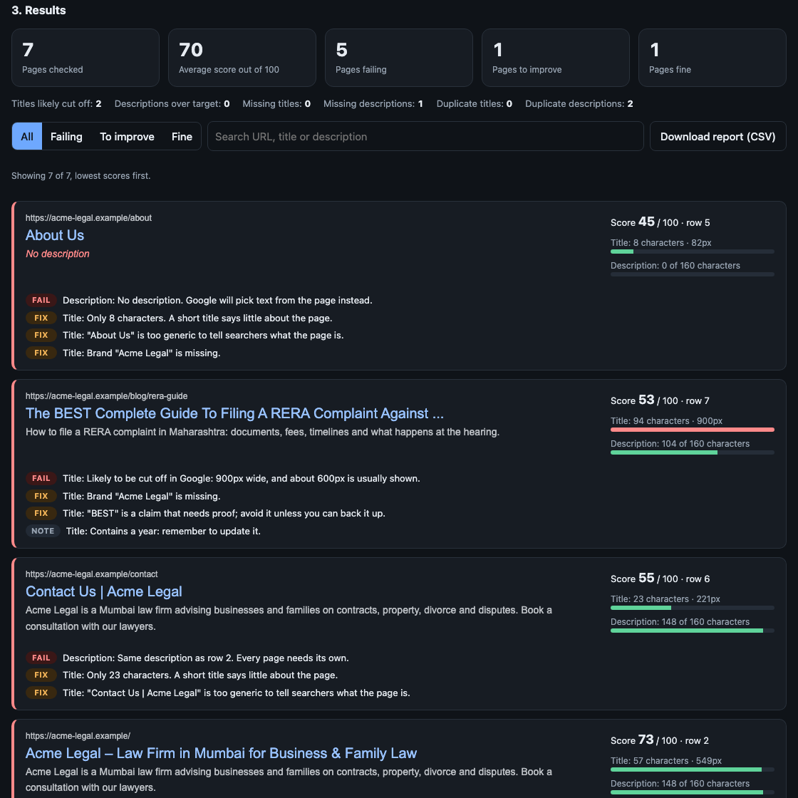

# Snippet Checker

**See how your page titles and meta descriptions will look in Google, before you publish them.**

**[Try it in your browser →](https://kawakicodes.github.io/snippet-checker/#demo)** (nothing to install; your data never leaves your browser)



## What it does, in plain words

- **Drop in a spreadsheet** (Excel or CSV) of your pages, or paste cells from Google Sheets. It finds the URL, keyword, title and description columns by itself, including exports from Shopify, Yoast and Screaming Frog, and prefers the new or optimised columns when old and new are side by side.
- **Measures every title in pixels**, using the font and size of Google's desktop results. Google shortens titles to fit the screen (about 600 pixels on desktop is the common estimate), not at a set number of characters, so a title full of wide letters like "W" is cut much sooner than one full of "i"s.
- **Shows a Google-style preview** of each page, shortened where Google is likely to shorten it.
- **Flags what to fix:** cut-off titles, missing titles or descriptions, duplicates and near-duplicates across the site, the brand missing or written twice, generic titles like "Home", unprovable claims like "best", and the main keyword missing.
- **Gives each page a score out of 100**, lists the worst pages first, and exports a full report to hand to a client or developer.

### Who it's for

Marketers and agencies who write or review titles and descriptions for many pages at once, and want to catch problems before the pages go live.

## Results

- **Raised a 494-page law-firm client site from an average score of 62 to 98**, cutting likely cut-off titles from 115 to 1, missing descriptions from 494 to 0 and duplicate titles from 64 to 0, by rewriting its titles and descriptions and checking every row with this tool before delivery.
- **Caught 7 titles in that delivered set that repeated the brand name**, which the earlier checking script had not looked for, by adding a site-wide brand check.
- **Checks all 494 pages in under a tenth of a second, and 3,000 near-identical pages in under a second**, by comparing each pair of descriptions with pre-built word sets that stop as soon as a pair can no longer match.
- **Closed all 6 high and 10 medium issues found in an independent review** before publishing, each locked in by one of 30 automated tests, by testing it as a first-time user, a developer and an accuracy checker who compared its widths with a real browser.

## How it decides

| Check | Rule |
|---|---|
| Title likely cut off | Wider than about **600px** at 20px Arial, the font and size of Google's desktop result titles. Measured against a real browser: within 3px for Latin text |
| Title length | Over your character target (default 60) or under 30 characters |
| Description length | Over your character target (default 160) or under 70 characters |
| Description width | Shown for information, not scored. The common "920px" figure equals only about 146 characters in Google's current 14px font, shorter than most advice |
| Duplicates | Same title or description as another page; near-duplicates share 80% or more of their words |
| Brand | Missing, written twice, or with a different separator from the rest of the site |
| Keyword | Main keyword missing from the title, or placed late; missing from the description |
| Wording | Generic titles ("Home", "About Us"), unprovable claims like "best" or "No. 1" (not when they are part of your brand or keyword), CAPITAL words, HTML code, double spaces, a year to keep updated |

Google publishes no fixed length for titles or descriptions: it shortens them "as needed, typically to fit the device width" ([title links](https://developers.google.com/search/docs/appearance/title-link), [snippets](https://developers.google.com/search/docs/appearance/snippet)). These checks use common estimates, not guarantees. Non-Latin scripts are measured more roughly (Japanese and Chinese as full-width characters).

## Use it

**In the browser:** open the [live page](https://kawakicodes.github.io/snippet-checker/), or open `index.html` from this folder.

**From the command line** (needs [Node.js](https://nodejs.org)):

```
node cli.js pages.csv --brand "Acme Legal" --out report.csv
```

Options: `--title-max 60`, `--desc-max 160`, `--title-col "New Meta Title"`, `--desc-col "New Meta Description"`, `--url-col`, `--keyword-col`, `--json`. CSV files saved in older Windows formats are read too. Exit code 0 means no failures, 1 means some pages failed, 2 means the file could not be read, which suits automated checks.

Try it on `sample.csv`.

## How it is built

- `checker.js`: all the rules, shared by the web page and the command line so both give the same answer
- `widths.js`: Arial character widths at 20px and 14px, generated from the font file by `tools/make_widths.py`
- `index.html`: the web page, plain HTML and JavaScript with no build step
- `vendor/`: [SheetJS](https://sheetjs.com) 0.20.3 for reading Excel files (Apache 2.0 licence included)
- `cli.js`: the command-line version
- `test/`: automated tests, run with `node --test`

Built with AI coding assistance.
